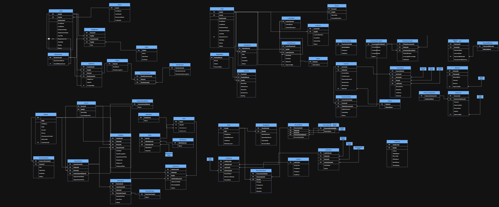

# Hospital Management System

[](https://github.com/brian-labs/Hospital-System/actions/workflows/ci.yml)

A Spring Boot backend for hospital operations: patient care, pharmacy, laboratory, billing and HR, on a 52-table PostgreSQL schema. The design priorities are data integrity under concurrent use, explicit transaction boundaries, and enforcing each business rule at the layer that can guarantee it.

## Status

- **Built:** the relational schema and ERD, eight versioned Flyway migrations, the application foundation (common exception hierarchy and API response types), and the identity and access module: users, roles, permissions and staff-role assignment behind REST controllers, with stateless JWT authentication, role-based access control and domain events for user and role changes.
- **Verified:** 15 automated tests (JUnit, Mockito and a PostgreSQL-backed repository test). CI rebuilds the database from zero through all migrations and runs the suite on every push and pull request.
- **In progress:** services and APIs for the remaining modules, starting with HR, followed by payroll settlement and the licence-expiry job.

## Architecture



Eight modules: Identity, Outpatient, Inpatient, Pharmacy, Laboratory, Finance, HR and System. The full schema is in the [ERD](docs/architecture/full.png).

Each request passes through three layers with separate responsibilities:

- **Controller:** request validation and DTO mapping. No business logic.
- **Service:** owns the transaction boundary and the business rules.
- **Repository:** persistence and queries.

Every failure, including authentication and authorisation failures, goes through one exception hierarchy and is returned in a single response shape, so clients never receive ad-hoc errors or stack traces.

## Key engineering decisions

**1. Rules live where they can be guaranteed.**
A rule that must hold for every caller and involves a single row is enforced by the database. A rule that depends on other rows or other modules is enforced in the service layer, inside a transaction. Database constraints protect the data from bugs, including ones that haven't been written yet, but they can't express cross-row workflow, and the service layer can't be the only line of defence.

| Database (constraints) | Service layer (transactions) |
|---|---|
| Valid staff types, unique employee numbers | Leave overlap and leave balance |
| One roster entry per staff, shift and date | No rostering during approved leave |
| Leave end date not before start date | Block new appointments for expired licences |
| Clock-out not before clock-in | Minimum ward staffing when publishing a roster |
| One payroll run per month | Disable the login when staff are terminated |
| Net pay = basic + allowances + overtime - deductions | Mark payroll Paid and record the expense together |

**2. Staff is the base table.**
Every employee has a `Staff` row, and `Doctors` extends it with clinical details. This keeps one person in one place, and staff who never log in simply have no linked user account. *Trade-off:* an extra join on doctor queries, in exchange for a single source of truth for employment, roster and payroll.

**3. Check-then-write rules are serialised, not hoped for.**
Leave overlap and leave balance are check-then-write, so two concurrent requests for the same person can both pass the check. The service takes a row lock on the staff record inside the transaction, so competing requests for one person queue while other staff are unaffected. Unique constraints remain as the final backstop. *Trade-off:* locks cost some throughput and need a consistent lock order to avoid deadlocks, which is why locking is scoped to one staff record.

**4. Payroll settlement is a single, retry-safe transaction.**
Marking a run as Paid updates the run and creates the salaries expense in Finance in one transaction. The status change is conditional (only an open run can be marked Paid), so a retry or a double click cannot record the expense twice. Paid runs are locked, and corrections go into the next run.

**5. Schema changes are forward-only and reproducible.**
Migrations are versioned Flyway scripts. An applied migration is never edited; fixes ship as a new version. Reference data such as shifts, leave types and departments is seeded through migrations, so every environment starts from the same state, and CI proves it by rebuilding an empty database on every push.

**6. Authentication is stateless.**
A filter validates a signed JWT on each request, and access is decided by roles and permissions, not by session state. Salary data is visible only to HR, Accountants and the staff member concerned. An audit log records important user actions.

**7. Time-based rules are idempotent.**
A scheduled job flags licences that expire within 60 days. It only sets a flag and reads from an index on the expiry date, so re-running it is safe. Doctors get a warning at 60 days and are blocked from new appointments at expiry.

## Testing and CI

Repository tests run against a real PostgreSQL instance, so constraints and migrations behave as they do in production. For example, a test asserts that the database rejects a duplicate username through its unique constraint. Service logic is unit-tested with Mockito. In CI, the suite runs against a PostgreSQL service container.

**Known limitations and next steps**

- Tests depend on a PostgreSQL instance supplied by the environment. Moving to Testcontainers would make them self-contained.
- Concurrency behaviour is designed but not yet covered by a test that fires simultaneous requests. That test comes with the HR leave workflow.
- JWT signing keys come from configuration. Key rotation is not implemented.

## Tech stack

Java 25, Spring Boot, PostgreSQL, Flyway, JUnit, Mockito, GitHub Actions

## Run locally

Requires Java 25 and PostgreSQL 17.

```bash
createdb hospital_db
export SPRING_DATASOURCE_URL=jdbc:postgresql://localhost:5432/hospital_db
export SPRING_DATASOURCE_USERNAME=<user>
export SPRING_DATASOURCE_PASSWORD=<password>
export APP_JWT_SECRET=<at least 32 characters>
export APP_JWT_EXPIRATION_MINUTES=60
./mvnw spring-boot:run
```

Flyway applies the migrations on startup. Run the tests with `./mvnw verify`.

## Roadmap

- [x] Schema design and ERD
- [x] Flyway migrations
- [x] Exception hierarchy and API response types
- [x] Identity module: users, roles and permissions (REST)
- [x] JWT authentication and role-based access control
- [x] CI: build and tests on every push
- [ ] REST APIs for the remaining modules, starting with HR
- [ ] Licence-expiry job
- [ ] Concurrency tests for check-then-write rules
- [ ] Testcontainers for self-contained integration tests

## Author

Brian Muigai - [portfolio](https://brianmuigai.vercel.app) - [LinkedIn](https://www.linkedin.com/in/brian-muigai/)
